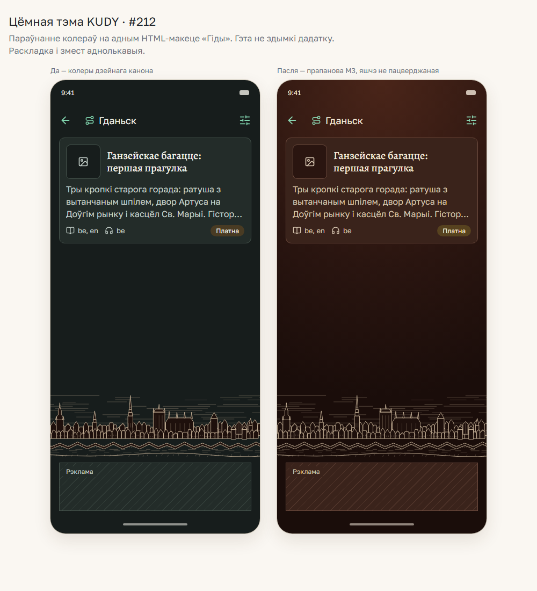

# Цёмная тэма M3 — палітра і градыент

*2026-11-11T21:56:13Z by Showboat 0.6.1*
<!-- showboat-id: 2ea929e4-5a42-45d6-8b88-b15877bdd69d -->

Уладальнік пацвердзіў правую палітру 2026-11-11 у задачы #212. Машынны канон, кантрастныя пары і native-токены павінны супадаць. Здымак параўноўвае колеры на HTML-макеце; гэта не прыладавая прыёмка.

```python
import subprocess, sys
result = subprocess.run(["node", "--no-warnings", "--test", "--test-reporter=dot", "test/design-dark-theme.test.mjs", "test/design-runtime-theme.test.mjs"], capture_output=True, text=True)
sys.stdout.buffer.write((result.stdout.strip() + "\n").encode("utf-8"))
if result.returncode:
    print(result.stderr)
    raise SystemExit(result.returncode)

```

```output
..................
```

```bash {image}

```



```python
import json, subprocess, sys
result = subprocess.run(["node", "node_modules/jest/bin/jest.js", "--runInBand", "--config", "jest.config.js", "--silent", "--json", "--runTestsByPath", "components/screen-surface.test.tsx", "components/paper-surface.test.tsx", "app/dark-theme-render.test.tsx"], capture_output=True, text=True, encoding="utf-8")
if result.returncode:
    print(result.stdout)
    print(result.stderr)
    raise SystemExit(result.returncode)
report = json.loads(result.stdout)
message = "Native render tests: %s passed, %s failed\n" % (report["numPassedTests"], report["numFailedTests"])
sys.stdout.buffer.write(message.encode("utf-8"))

```

```output
Native render tests: 25 passed, 0 failed
```

```python
import platform, subprocess, sys
lines = ["Host: " + platform.system(), "Node: " + subprocess.check_output(["node", "--version"], text=True).strip(), "core.autocrlf: " + subprocess.check_output(["git", "config", "core.autocrlf"], text=True).strip()]
sys.stdout.buffer.write(("\n".join(lines) + "\n").encode("utf-8"))

```

```output
Host: Windows
Node: v24.13.0
core.autocrlf: true
```
