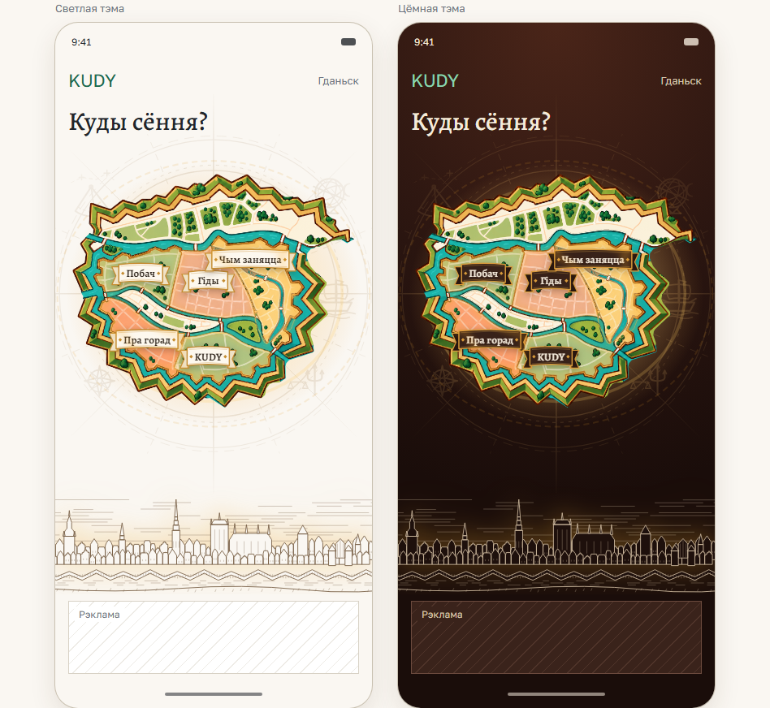

# Атласныя стужкі галоўнага меню

*2026-11-27T00:06:01Z by Showboat 0.6.1*
<!-- showboat-id: ac3018f0-c220-4482-9584-e61d13dd6cba -->

У кананічным каталогу адкрываецца галоўнае меню з пяццю стужкамі. Chromium правярае ўсе мовы, два маштабы тэксту, зборку і захаваныя архіўныя варыянты. Тэсты мадэлі правяраюць націск і перацягванне за межамі контуру кавалка, а таксама абрэзку сцэны.

```bash
node --disable-warning=MODULE_TYPELESS_PACKAGE_JSON --test --test-reporter=dot docs/design/brand/outputs/menu-map-city-only/native/model.test.mjs test/menu-atlas-browser.test.mjs
```

```output
....................
..........
```

```bash {image}

```


