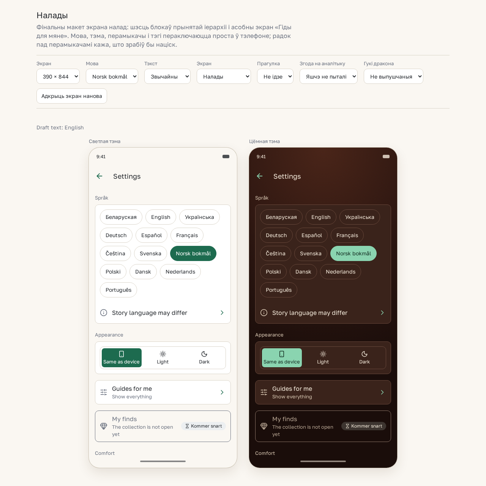

# Крытычныя мовы макетаў і бачная запасная мова

*2026-11-26T23:16:51Z by Showboat 0.6.1*
<!-- showboat-id: 84a9a770-4fb7-412c-be98-31474e12b800 -->

Для лакальных чарнавых радкоў «Налады» і «Прагулкі» бярэцца абраная мова, а пры яе адсутнасці — англійская і толькі потым беларуская. Дошка паказвае фактычную запасную мову па-за рамкамі тэлефона.

```bash
node --test --test-reporter=dot test/design-critical-locales-browser.test.mjs
```

```output
..............
```

```bash {image}

```


