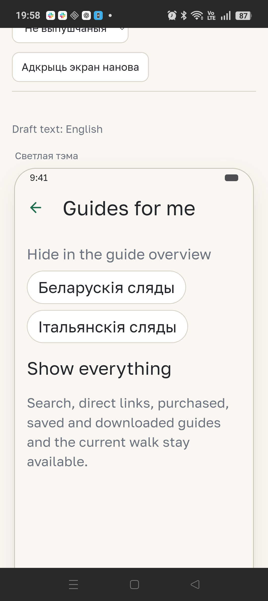

# Пусты статус спіса гідаў

*2026-11-27T19:02:48Z by Showboat 0.6.1*
<!-- showboat-id: 3c1620b7-0a3d-480f-b3c3-7e492ccf3631 -->

Калі ўсе групы паказаныя, экран Guides паказвае «Show everything» без літаральнага тэксту false. Пасля схавання групы зʼяўляецца статус лічыльніка і кнопка скіду.

```bash
node --test --test-reporter=dot --test-name-pattern='Guides screen does not render a false status' test/design-guides-false-status-browser.test.mjs
```

```output
.
```

```bash {image}

```


