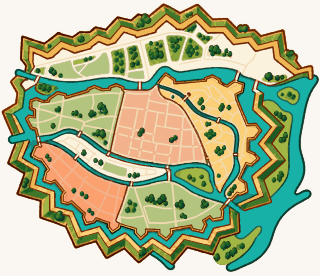
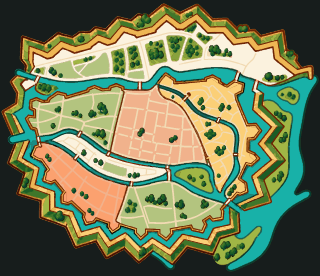

# Экспарт пяці фрагментаў карты

Пакет для [#79](https://github.com/kudy-vk/KUDY/issues/79) паўторна выкарыстоўвае [вектарны майстар](../MAP-02/vector/README.md), [геаметрыю MAP-03](../MAP-03/README.md) і альфа-маскі існых пяці частак. Майстар застаецца ў статусе `draft`; экспарт не азначае прыёмку графікі або яе ўкараненне ў дадатак.

## Адна каманда

Патрэбныя Python з залежнасцямі з [requirements.txt](../MAP-02/vector/requirements.txt), `npm ci` ў корані і Google Chrome. Скрыпт выкарыстоўвае існы [рэндэрэр](../MAP-02/vector/render.mjs), не перамалёўвае майстар і не запускае яго вектарызацыю.

```sh
python docs/design/brand/outputs/MAP-04/export_map.py
```

`--out-dir DIR` задае іншы каталог. Экспарт спачатку збіраецца і правяраецца ў часовым каталогу; маніфест капіюецца апошнім. Памылка рэндэру не публікуе новы маніфест. Перарваны перанос можа пакінуць няпоўныя файлы: праверка адхіліць іх, паўторны экспарт адновіць пакет.

## Змест і каардынаты

У [assets/manifest.json](assets/manifest.json) ёсць `mapVersion`, межы, контуры, апорныя пункты і суседзі з MAP-03, адбіткі ўваходных файлаў і SHA-256 з памерамі кожнага асета. Змена ўваходнага файла патрабуе паўторнага экспарту. Існыя ID захоўваюцца.

| Файлы | Прызначэнне |
|---|---|
| `<id>.svg` | Самастойная вектарная выразка: поўная графіка майстра пад дакладнай вектарнай маскай, без `<image>`, устаўленых PNG або знешніх рэсурсаў. |
| `<id>@1x.png`, `@2x.png`, `@3x.png` | Тая ж частка з празрыстасцю ў трох шчыльнасцях. За 1× прыняты піксель майстра, не dp экрана. |
| `scene.svg`, `scene@Nx.png` | Дапаўненне пяці частак да цэлай карты, уключаючы ўнутраныя каналы. |
| `master@Nx.png` | Кантрольны рэндэр таго ж майстра для кожнай шчыльнасці. |
| `preview-light-320.png`, `preview-dark-320.png` | Цэлая карта на шырыні 320 px на кананічных светлым і цёмным фонах. Гэта агляд асета, не здымак дадатку. |

Для SVG зададзены `viewBox="x y width height"` у каардынатах майстра 1351 × 1164. Каб скласці карту ў renderer, размясці частку ў `(x × s, y × s)` з памерам `(width × s, height × s)`; усе часткі і сцэна выкарыстоўваюць адзін `s`. Расце толькі шчыльнасць PNG, каардынаты маніфеста не мяняюцца. Тэкст і значкі меню застаюцца па-за графікай.

Вонкавы контур MAP-03 спрошчаны і сам па сабе не захоўвае ўсе адтуліны. Таму `clipPath` дакладна апісвае існую альфа-маску прамавугольнікамі па межах яе пікселяў. Гэта вектарная копія існай маскі без апроксімацыі.

PNG выразаюцца з аднаго рэндэру майстра для кожнай шчыльнасці. Пры асобным рэндэры Chrome можа крыху інакш акругляць колеры пад SVG-clip; агульны рэндэр пазбягае гэтага. MAP-04 перадае рэндэрэру `softwareRaster: true`, каб адключыць GPU: яго акругленне таксама адрознівалася паміж асобнымі сесіямі Chrome. Ранейшы экспарт MAP-02 захоўвае свой рэжым. Праверка SVG патрабуе дакладнага супадзення графікі і clip з крыніцай. Праверка PNG патрабуе дакладнага супадзення кожнага RGBA-пікселя: няма дапушчальнага працэнта памылкі. Паўторны экспарт на тым самым Chrome павінен даваць тыя ж байты; гэта правярае Python-тэст. Гэтыя праверкі не сцвярджаюць байтавую роўнасць растэрызацыі розных SVG-рухавікоў або версій Chrome.

Бюджэт усяго пакета — 24 MiB, уключаючы SVG, тры шчыльнасці і кантрольныя выявы. Ліміт правяраецца да публікацыі; фактычны памер запісаны ў маніфесце. Метад захоўвае майстар у кожным самастойным SVG, таму яны важаць больш за растравыя выразкі. У production трэба браць толькі патрэбную форму і шчыльнасць, не ўсе кантрольныя файлы.

## Праверкі

```sh
python docs/design/brand/outputs/MAP-04/export_map.py --verify
python docs/design/brand/outputs/MAP-04/test_export.py
node --test test/menu-map-export.test.mjs
```

Python-тэсты выконваюць сапраўдны экспарт і асобна псуюць PNG і SVG-clip з абноўленымі кантрольнымі сумамі: так правяраецца геаметрыя, а не толькі хэш. Node-праверкі ўваходзяць у `npm test` без Python-залежнасцей CI і кантралююць маніфест, усе адбіткі, LF для хэшаваных тэкстаў, вектарны фармат і дакладную зборку PNG.

Для [Showboat-доказу](../../../../demos/2026-11-11-map-04-export.md) задай `MAP04_PYTHON`, калі залежнасці стаяць у асобным Python-асяроддзі; затым запусці `uvx showboat==0.6.1 verify docs/demos/2026-11-11-map-04-export.md`.




[Вынікі і непацверджаныя пункты](../../../../agent-tasks/results/MAP-04.md). [Публікацыя існай ілюстрацыі](../../../../agent-tasks/results/MAP-02-RIGHTS.md).
